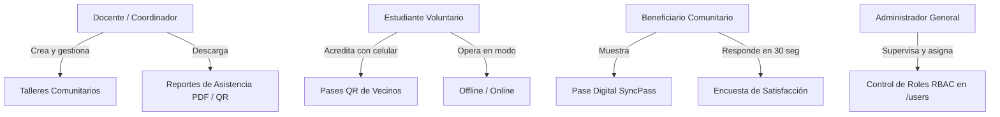

# Especificación del Caso de Negocio: SyncPass

> **Institución:** Duoc UC  
> **Área:** Escuela de Informática y Telecomunicaciones  
> **Ecosistema:** Vinculación con el Medio • Innovación Social  
> **Sistema:** SyncPass (Plataforma Territorial de Acreditación y Evaluación)

---

## 📖 1. Contexto y Problemática

Las instituciones de educación superior como **Duoc UC** realizan periódicamente actividades de **Vinculación con el Medio** en diversos sectores de la comunidad (juntas de vecinos, escuelas públicas, centros comunitarios periféricos). 

Estas actividades incluyen:
- Talleres de alfabetización digital para personas mayores.
- Capacitaciones de finanzas personales y emprendimiento.
- Operativos de salud preventiva y primeros auxilios barriales.
- Talleres medioambientales y creación de huertos urbanos comunitarios.

### Desafíos Detectados en Terreno:
1. **Conectividad Inestable o Inexistente:** Las sedes comunitarias suelen tener señal celular débil y carecen de redes Wi-Fi confiables.
2. **Listas Manuales en Papel:** Pérdida de información, digitación posterior propensa a errores y demoras en reportar la asistencia a Duoc UC.
3. **Falta de Trazabilidad en Encuestas:** Las encuestas de satisfacción en papel tienen muy baja tasa de respuesta o se extravían antes de ser tabuladas.

---

## 🎯 2. La Solución SyncPass

**SyncPass** es una solución integral compuesta por:
1. **Aplicación Móvil Android (Kotlin):** Utilizada por los estudiantes voluntarios en terreno para escanear pases digitales QR, registrar asistencias de forma offline y levantar encuestas de 30 segundos.
2. **Portal Web Fullstack (React 19 + TypeScript + Vite):** Utilizado por los docentes coordinadores y administradores para programar talleres, monitorear asistencias en tiempo real, generar códigos QR y analizar métricas de impacto territorial.
3. **Infraestructura Cloud (AWS Cognito + BFF):** Para la gestión segura de identidades institucionales y sincronización diferida de datos.

---

## 🎭 3. Actores del Sistema (4 Roles)

### 1. Docente / Coordinador (`coordinator`)
- Planifica los talleres comunitarios (nombre, sede vecinal, fecha, cupos).
- Genera el código QR del evento para desplegarlo en la entrada de la sede.
- Consulta en vivo la asistencia de beneficiarios.

### 2. Estudiante Voluntario (`volunteer`)
- Llega a la junta de vecinos y activa el **Modo Acreditación**.
- Si no hay señal de internet, el sistema almacena las asistencias en la base de datos local y muestra el contador de registros pendientes de sincronizar.
- Al recuperar conexión, sincroniza en un clic con la nube.

### 3. Beneficiario Comunitario (`attendee`)
- Recibe un pase digital QR personal con su identificación.
- Al ingresar al taller, el voluntario escanea su código y en la misma pantalla el beneficiario responde una encuesta de satisfacción rápida (1 a 5 estrellas).

### 4. Administrador General (`admin`)
- Gestiona el acceso al sistema (`/users`).
- Asigna roles y supervisa el impacto territorial global de Duoc UC.
